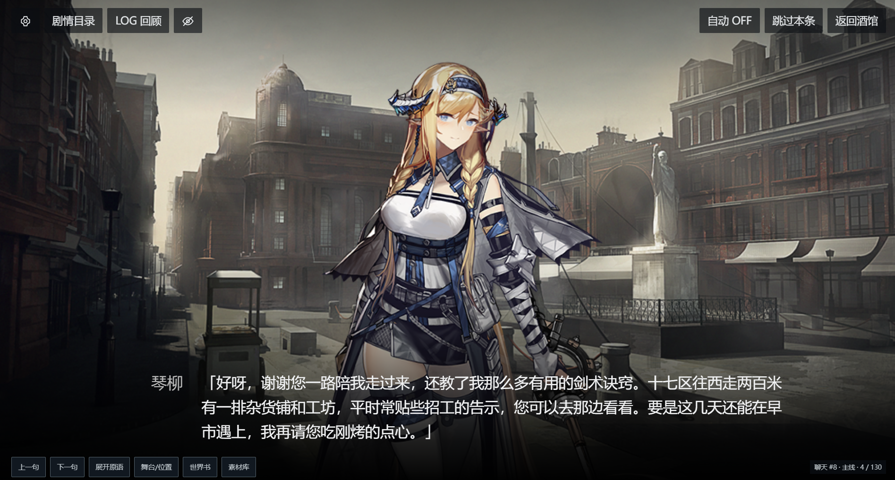
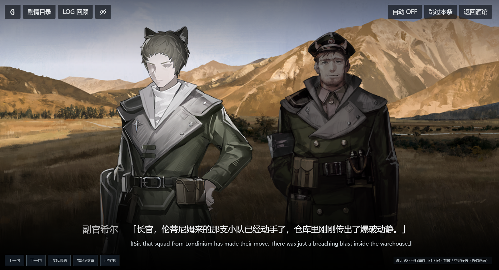
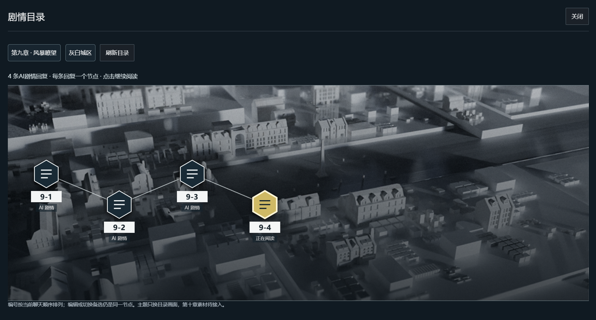
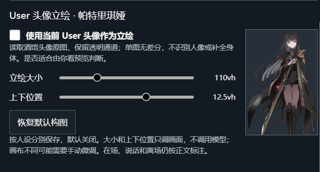

# 风暴瞭望 · AI 剧情播放器

**把酒馆里的故事，变成《明日方舟》风格的剧情演出。**

在 SillyTavern 中写下你的行动，让 AI 生成正文。
在这之后，再让一个模型自己选择背景、人物立绘、表情差分和逐句对白，由此生成贴近明日方舟原版剧情演出的阅读方式。

当前提供第九章「风暴瞭望」的美术素材，剧情由你和 AI 共同展开。

*你熟悉的角色，正在讲述这一次属于你的故事。*
*图中正文由 AI 生成；AI 根据正文编排人物出场和发言高亮，并从已有《明日方舟》素材中选择立绘、表情差分和背景。*

## 故事有了画面

播放器会为已有回复安排演出：谁在场、谁说话、用哪张背景，以及切换什么表情。点击继续阅读，也可以开启自动播放，或从 LOG 回顾全文。

| 人物对白 | 剧情目录 |
| --- | --- |
|  |  |
| 发言者亮起，其他人物退到暗处；正文附带的原语可以展开查看。 | 每条 AI 回复都是一个节点，点选即可重新阅读。 |

- **人物与表情**：按故事内容匹配已有立绘和差分，支持多人出场、旁白与通讯演出。
- **背景随场景变化**：街巷、室内、树林、荒野……从素材库中选择合适的画面。
- **随时回看**：上一句、下一句、自动播放、跳过本条，以及可以跳转的 LOG。
- **保留你的故事**：标注只安排画面，不改写聊天正文。缺少图片或标注失败时，仍能继续阅读。

本版包含 178 张 PNG，涵盖人物差分、背景、剧情插图和目录底图，并加入莫斯提马补充立绘。

## 0.3.9 更新

- **入口更好找**：左上角直接显示「设置」，素材库收进设置面板，阅读底栏更简洁。
- **兼容更多预设正文**：修正两类已测试预设的正文提取与对白拆分，识别花括号姓名和普通中文引号，避免把辅助规划当作故事播放。
- **续写后仍能回看**：预设只给上一条回复追加已识别的辅助内容时，保留已有演出和人物延续；故事正文或相关前文改变时仍重新核对。
- **保存结果更可靠**：保存后回读聊天确认；未保存成功的演出会保留待处理结果，可「重试保存（不调用模型）」或下载备份。浏览器无法保留备份时会明确提示。

两份预设已连同附带的正则和助手脚本进行实际测试。新解析规则影响的旧回复可能需要主动重新标注一次；升级本身不会发出模型请求。测试范围见 [版本验证记录](VALIDATION.md)。

## 0.3.8 更新

- **缓存满了也能保存演出**：标注和手动舞台修正直接随聊天保存，不再往浏览器里重复存一整份。
- **继续读取已有演出**：优先使用聊天里的记录，兼容旧版浏览器缓存；更新后不需要重做已经成功保存的标注。
- **阅读不中断**：浏览器无法保存阅读位置或显示设置时，会提示这些设置暂存在本页，刷新可能丢失；仍可继续播放。

## 0.3.7 更新

- **读得更连贯**：正文每页最多三行，能放下的整句保持完整；过长句子优先在自然停顿处分开。跳过无正文的空页，原语在独立区域滚动。
- **人物更协调**：修正 Outcast、拉芙希妮等人物的身份与候选处理，区分号角的害羞和惊讶差分；校准主要人物及已确认通用 NPC 的同屏大小，加入莫斯提马立绘。
- **演出更稳妥**：修正 NPC 登记遗漏、单个人物选图失败拖累整段、预设辅助内容混入正文、窄窗口按钮遮字，以及部分室内背景误用的问题。

自动标注仍可能漏配新 NPC，缺少对应素材的地点也只能使用近似背景。已验证的范围与未测项见 [版本验证记录](VALIDATION.md)。

## 让自己的角色也登场

如果你的 User 头像适合用作立绘，可以在设置里开启「使用当前 User 头像作为立绘」。角色出现和发言时，也会参与出场、亮暗切换等演出。

可以调整立绘大小和上下位置，设置按人设分别保存。这个选项默认关闭：头像不合适，或你扮演的是已有立绘的原作角色时，都可以保持关闭。头像以原图展示，适合使用透明背景的全身立绘。

## 开始使用

准备好 **SillyTavern** 和 **酒馆助手**，以及一个用于演出标注的模型接口。

[下载 0.3.9 酒馆助手脚本](https://epsilonmeow.github.io/arknights-story-player/install/风暴瞭望-0.3.9.json)

1. 在酒馆助手的脚本库中导入播放器脚本并开启。已有旧版时，先关闭旧脚本。
2. 点击播放器左上角「设置」，填写自己的接口地址和 Key，点击「拉取模型列表」选择模型，再保存连接。无密钥的本地接口可以留空 Key；也可以直接手填模型名称。
3. 像平常一样在酒馆生成故事，再回到播放器读取回复，点击「请求演出标注」。
4. 标注完成后，关掉设置，点击画面开始阅读。

演出标注会额外调用一次你选择的模型，费用由你的接口服务商计算。正文仍使用酒馆里原来的连接；回看已有标注不需要重复请求。

本轮已测试环境：SillyTavern 1.18.0、酒馆助手 4.12.0；此前已核对 4.11.0 的所需接口。

更新时先关闭旧播放器，再导入并开启新版。已有演出通常可以继续回看；解析规则或人物身份变化影响的记录会提示重新标注。升级不会自动补齐旧标注里遗漏的人物，也不会自动发出模型请求。希望修正旧选图时，再主动重新标注对应回复。

## 常见问题

**一定要照着第九章主线玩吗？**  
不用。第九章提供人物和美术素材，故事可以自由展开。

**没有某个人物的立绘怎么办？**  
对白照常显示。玩家角色不会被随意替换成共享 NPC；你可以选择使用自己的头像。

**人物或背景选得不合适怎么办？**  
可以查看「舞台／位置」调整画面，或在设置中选择「重新标注演出」。重新标注会发出新的模型请求。

**需要把 Key 交给作者吗？**  
不需要。你在自己的酒馆填写连接，Key 不随聊天或脚本导出。

## 致谢与声明

感谢 [SillyTavern](https://github.com/SillyTavern/SillyTavern) 与 [酒馆助手](https://github.com/N0VI028/JS-Slash-Runner) 提供运行环境，感谢《明日方舟》带来的角色与世界。

本项目是玩家制作的非官方同人工具，与鹰角网络、Yostar 无隶属或合作关系。相关游戏素材的版权归原权利人所有，与播放器代码的许可分开处理。项目免费提供，供玩家交流和个人使用，请勿用于售卖整合包、收费分发等商业用途。权利方如有异议，请通过 [Issue](https://github.com/Epsilonmeow/arknights-story-player/issues) 联系，我们会及时处理并移除相关内容。
